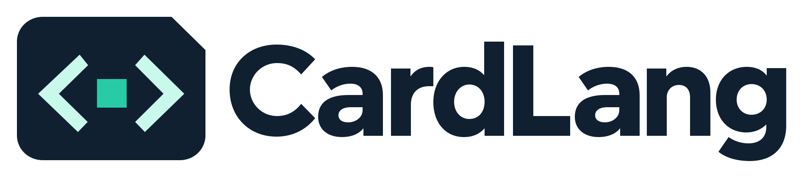

<p align="center">
  <picture>
    <source media="(prefers-color-scheme: dark)" srcset="assets/cardlang-logo-dark.svg">
    
  </picture>
</p>

CardLang is a small, statically typed, imperative language for secure applications that run isolated on small devices. That covers trusted applications on microcontrollers, code in a TrustZone secure world or in a partition walled off by the memory protection unit, and smart-card applets too.

This repository has everything around the language. There's the language itself, with its specification, a conformance test suite and the reasoning behind its design, and a platform profile that defines the APIs a platform gives programs (keys, crypto, CBOR, TLV) and how messages reach them. The toolchain includes reference checkers, a compiler to a compact bytecode, a reference interpreter and a Python VM, and a VM written in portable C11 runs the same compiled images and passes the same tests. There's also a VS Code extension, with errors as you type, completion, building and a debugger, and two example applets, a FIDO2 authenticator and a PIV card application.

CardLang is under active development.

## The language at a glance

```text
errors CounterError {
    MalformedRequest = 1;
    UnsupportedOperation = 2;
    ResponseTooSmall = 3;
}

const OP_READ: u8 = 0x01;
const OP_INCREMENT: u8 = 0x02;

persistent counter: u32;

command process(request: ref u8[], response: inout u8[]) -> u32 {
    require request.length == 1 else CounterError.MalformedRequest;
    require response.length >= 4 else CounterError.ResponseTooSmall;
    var operation: u8 = request[0];
    if operation == OP_READ {
        response[0..4] = encode_be(counter);
    } else if operation == OP_INCREMENT {
        counter = counter + 1;
        response[0..4] = encode_be(counter);
    } else {
        return Err(CounterError.UnsupportedOperation);
    }
    return Ok(4);
}
```

All data has a fixed size. The types are the integers `u8`–`u32` and `i8`–`i32`, `bool`, enums, structures and fixed arrays `T[N]`, and there's no heap, no strings, no floating point and no implicit conversion. State is explicit, too. A global is `persistent`, surviving power loss, `session`, cleared at power-on and reset, or `const`. Every assignment to persistent state is atomic, and `transaction { … }` groups several of them together.

There are no exceptions. Every call returns `Ok(…)` or `Err(…)`, and the caller has to handle it, with `match`, `attempt`, `require` or a forwarding `return`. Faults such as an overflow or an out-of-range index are *traps*, which behave the same way every time. Functions take `ref` and `inout` parameters instead of pointers, and slices are passed as views, but a reference can never be stored or returned.

An applet has one entry point, a `command` that receives the request bytes and writes the response. The language itself has no transport, status words or command dispatch. There's no recursion either, so the call graph is fixed, and an applet's stack needs and the nesting of its transactions can be checked before it ever runs.

## The VM at a glance

Applets run on the CardLang VM, which is small enough for deeply embedded targets. It's written in portable C, with no heap and no recursion, and roughly needs:

- around 20 KB of code for the VM, the interpreter and its native library;
- around 250 bytes for the VM's state;
- a C stack of a few kilobytes at most;
- whatever stack and global state the applet itself needs. That depends on the applet, but it's known exactly when the applet is built, and `clc build` reports it, so you can fit an applet to your budget.

These leave out what the device's platform supplies itself: its hardware layer, its cryptography, and the driver for its persistent storage.

## The CardLang Guide

**[The CardLang Guide](https://cardlang.github.io/cardlang/)** teaches the language by building one applet, a small PIN-protected store for a secret, a chapter at a time. It starts with a counter and goes on through persistent state, transactions, signing keys, testing and debugging, to a guided reading of the FIDO2 example. Every example in it is compiled and run by the repository's checks. The last chapter is for readers who know C or Java Card, and a reference of the platform's APIs comes after it.

## The VS Code extension

The VS Code extension is the easiest way into the language. It highlights applets and scenario files, colouring each name by what it is, and shows errors as you type, across all of an applet's files, each with its code from the specification. Go to definition and completion work everywhere, including on the platform's APIs, which come with their signatures, errors and documentation. You can build, check and run an applet and its scenarios from the editor, and step through it in a debugger, with breakpoints in the applet or in a scenario, the call stack, variables and persistent state, and stops on traps and failed expectations.

Download `cardlang-<version>.vsix` from the [latest release of the extension](https://github.com/cardlang/cardlang/releases) and install it from the Extensions view. You don't need anything else, because the extension carries its own copy of the toolchain and offers to set it up the first time you open an applet. The setup downloads [uv](https://docs.astral.sh/uv/), checks it against a hash the extension carries, and installs the toolchain into VS Code's storage. When a clone of this repository is open, the extension uses the clone's toolchain instead. [Chapter 1 of the guide](https://cardlang.github.io/cardlang/01-getting-started/) walks through installing it and through building, running and debugging a first applet, and the [extension's README](editors/vscode/README.md) covers its commands and settings.

## Repository layout

| Path | Contents |
|---|---|
| [`guide/`](guide/README.md) | The CardLang Guide, which teaches the language by example; published at [cardlang.github.io/cardlang](https://cardlang.github.io/cardlang/) |
| [`language/`](language/README.md) | The language definition |
| [`language/spec/`](language/spec/00-index.md) | the specification: chapters 1–13, plus Annex A (grammar), B (platform contract), C (open issues) and D (traceability). Start at [`language/spec/00-index.md`](language/spec/00-index.md) |
| [`language/conformance/`](language/conformance/README.md) | 412 tests: `valid/`, `invalid/` (each naming the expected compile error) and `runtime/` scenarios, plus a fictional test-only platform API catalog |
| [`language/rationale/`](language/rationale/) | the design notes, the platform notes and the decision register, which the rules cite |
| [`language/releases/`](language/releases/) | the Draft 0.2 release notes, and the candidates for Draft 0.3 |
| [`platform/`](platform/README.md) | The CardLang Base Profile 1, a platform specification separate from the language: API conventions, platform types (`base-types.card`), `CardError` codes, keys, crypto, CBOR, TLV, transport bindings and the API catalog (`base-catalog.txt`) |
| [`examples/`](examples/README.md) | The example applets, each self-contained, with its sources, scenarios, its own checker and a README |
| [`examples/fido2/`](examples/fido2/README.md) | a FIDO2 (CTAP 2.0) authenticator, with PIN protocols two and one |
| [`examples/piv/`](examples/piv/README.md) | a PIV card application (NIST SP 800-73-5, contact-interface subset) |
| [`src/cardlang/`](src/cardlang/README.md) | The Python toolchain, one package installed by `uv sync`: the reference checkers (the front end), the compiler, the reference interpreter, the Python VM, the harness, the command line `clc`, the language server and the debug adapter |
| [`tests/`](tests/README.md) | `run_checks.py`, and the checks of the tools and of the definition |
| [`editors/`](editors/README.md) | The VS Code extension, in `editors/vscode/` |
| [`vm/`](vm/README.md) | The VM's design (execution model, HAL, bytecode, image format) and the C VM (`vm/c/`) |
| [`devel/`](devel/README.md) | Development aids: the plans, measurement reports and findings, test generators, and history and measurement scripts. A record of how the project was built, kept apart from the rest |

## Licence

Everything in CardLang is licensed under the [Apache License, Version 2.0](LICENSE), including the specification and the other documents, the toolchain, the C VM, the editor extension and the examples. See also [`NOTICE`](NOTICE).

The repository contains no third-party code. The tools fetch these components, each under its own licence:

| Component | Used by | Licence |
|---|---|---|
| [Mbed TLS](https://github.com/Mbed-TLS/mbedtls) 3.6.8 | the C VM's host HAL, downloaded and checked against its SHA-256 by the build | Apache-2.0 or GPL-2.0-or-later |
| [cffi](https://cffi.readthedocs.io/) | the harness, to drive the C VM from Python | MIT-0 |
| [vscode-languageclient](https://github.com/microsoft/vscode-languageserver-node) | the VS Code extension, bundled into its package | MIT |
| [@vscode/vsce](https://github.com/microsoft/vscode-vsce) | packaging the extension | MIT |
| [uv](https://github.com/astral-sh/uv) | the VS Code extension's own setup, downloaded and checked against its SHA-256 | MIT or Apache-2.0 |
| [python-fido2](https://github.com/Yubico/python-fido2), with [cryptography](https://github.com/pyca/cryptography) | the checks: an independent FIDO2 client and server for the FIDO2 example | BSD-2-Clause; Apache-2.0 or BSD-3-Clause |
| [pyscard](https://github.com/LudovicRousseau/pyscard) | talking to a smart card reader, in the `reader` dependency group | LGPL-2.1-or-later |
